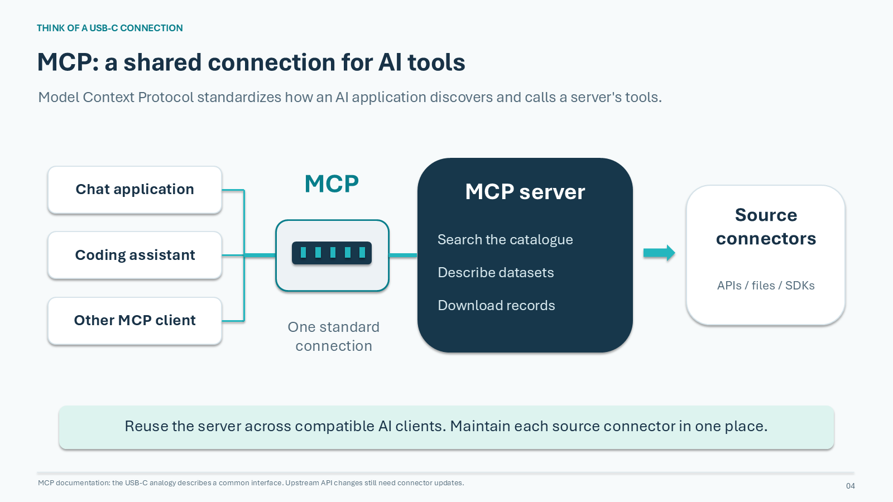

*Versión en español [aquí](index_es.qmd).*

:::{.callout-note}
## Why it matters

In my work with databases that have a lot of material to explore, I find it easier to start from the research question.
With Fisheries Data MCP, I put that question to the AI assistant and ask it to search the catalogue.
The assistant explains the variables, units and coverage before downloading the data with the source metadata.
This lets me decide which data I can use before asking for the files.
:::

:::{.callout-warning}
## Before you start

Some sources require you to create an account or obtain a free key.
Each person has to do this themselves.
No one can do it for them.
The [available sources](#available-sources) table shows what you need for each one.
:::

## What is an MCP

MCP stands for *Model Context Protocol*.
It is a standard protocol for making tools and APIs available to language models through a common interface.
The assistant can use them without a custom integration for each connection.
Miao and coauthors explain this on the second page of their article on Paper2Agent, published in *Nature* ([doi:10.1038/s41586-026-11044-y](https://doi.org/10.1038/s41586-026-11044-y)).
Their example is AlphaGenome, which can be used through a natural-language question once connected, instead of cloning repositories and configuring dependencies for each use.

The analogy is a USB-C port.
A common connection lets you connect different tools to the same assistant.
You can also connect several MCP servers to a single assistant.

The article describes three kinds of components, tools that execute functions, resources that provide content and prompts that give instructions for a workflow.
Fisheries Data MCP currently exposes only tools.
The work of Miao and coauthors inspired me to think of a collection of databases accessible through the assistant.
They turn papers into agents, while this server connects fisheries and marine data sources.

## The problem it solves

Each source has its own way in.
UN Comtrade uses a trade API with product codes.
FishStat provides ZIP files with its own schema.
BarentsWatch uses OAuth and a fish-health API.
Copernicus Marine uses a catalogue and subset requests by variable, area and dates.

The server brings these connections together so the assistant can find the tools and request data from them.
If an API changes, its integration in the server needs to be updated.
MCP standardizes the connection with the assistant, but it does not maintain the providers' APIs.

## What it can do today, as of November 18, 2026 {#available-sources}

::: {style="font-size: 0.9em; hyphens: auto; overflow-wrap: anywhere;"}

| Source | What it provides | What you need |
| --- | --- | --- |
| FAO FishStat | Capture and aquaculture production quantities, and aquaculture production values. | Nothing. |
| BarentsWatch | Norwegian aquaculture sites, lice, temperature, treatments, diseases, escapes, permitted capacity and site details. | API client ID and secret. |
| Copernicus Marine | Ocean datasets selected by variable, area and dates. | An account for downloads. |
| UN Comtrade | Annual or monthly goods trade by country, partner, HS product and flow. | A free API key for downloads. |

:::

For example, you can ask the question from the [repository FAQ](https://github.com/adamsconchallos/fisheries-data-mcp/blob/main/FAQ.md).

> I want to study salmon production, production value and salmon lice in Norway by year.
> Which datasets available through this MCP could help?
> Explain their variables, units, years and observation levels.
> Distinguish connected downloads from sources that require another access route, and identify any missing information.
> Do not analyse the data yet.

The assistant identifies which data could help, which source they come from and which require another access route.
In this example, FishStat provides annual production quantities and values.
Those are production values, not export values.
BarentsWatch provides weekly fish-health reports by site.
Building a national annual lice indicator requires decisions about how to aggregate and weight those reports.
The server provides the data for that work.

An entry marked `downloadable` has connected download tools, while `catalogue_only` describes data that require another access route.
Availability for your selection still depends on the species, place, period and your credentials.

## What it does not do

The server finds, describes and downloads data.
It does not analyze or join datasets.
A missing value is not a zero, and a catalogue entry does not guarantee a complete series for your selection.

AI can make mistakes.
Before using the data, check the units and reporting flags in the metadata JSON file and the downloaded files.
Each provider's terms also apply and are linked in the [Attribution section of the technical reference](https://github.com/adamsconchallos/fisheries-data-mcp/blob/main/docs/REFERENCE.md#attribution).

## How to try it

Give the [repository](https://github.com/adamsconchallos/fisheries-data-mcp) link to your favorite AI assistant and ask it to read it and connect the server.
To install it, the assistant needs to be able to run commands on your computer, as Codex or Claude Code can.
A chat without access to your machine can explain the steps.
Once installed, the server also works in desktop apps that accept local MCP servers, such as Claude Desktop.
A chat in a web browser cannot start it.
You need Python 3.11 or newer.
Ask the assistant to explain each step before running it.

You create the accounts and keys for the sources yourself.
You can consult the [README](https://github.com/adamsconchallos/fisheries-data-mcp/blob/main/README.md), the [FAQ](https://github.com/adamsconchallos/fisheries-data-mcp/blob/main/FAQ.md) and the [installation guide](https://github.com/adamsconchallos/fisheries-data-mcp/blob/main/INSTALL.md).

## What comes next

I will keep improving the server.
The next planned step is to add FOSS, the Fisheries One Stop Shop from NOAA Fisheries.
Once it is connected, I will share a short update post.

## The slides

I prepared these slides for the Aquaculture Economics & Management Workshop in Ljubljana, September 28–30, 2026.
You can [download the slides as a PDF](fisheries_data_mcp_overview.pdf).
Slide 2 is a screenshot of the *Nature* article page.

The slides are out of date on the available databases.
For example, they show UN Comtrade as 'planned' and it is now connected.

## References

Miao, J., Davis, J. R., Zhang, Y., Pritchard, J. K., & Zou, J. (2026).
Reimagining research papers as interactive and reliable AI agents.
*Nature*, published online on September 16, 2026.
[doi:10.1038/s41586-026-11044-y](https://doi.org/10.1038/s41586-026-11044-y).

[Model Context Protocol documentation](https://modelcontextprotocol.io/).

[Fisheries Data MCP repository](https://github.com/adamsconchallos/fisheries-data-mcp).
