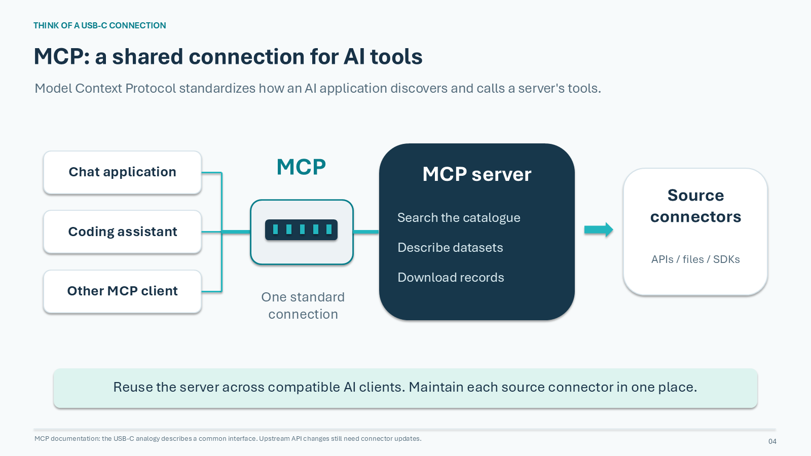

*English version [here](index.qmd).*

:::{.callout-note}
## Por qué importa

En mi trabajo con bases de datos que tienen mucho material por explorar, me resulta más sencillo partir de la pregunta de investigación.
Con Fisheries Data MCP, le planteo esa pregunta al asistente de IA y le pido que busque en el catálogo.
El asistente explica las variables, las unidades y la cobertura antes de descargar los datos con los metadatos de la fuente.
Así puedo decidir qué datos me sirven antes de pedir los archivos.
:::

:::{.callout-warning}
## Antes de empezar

Algunas fuentes requieren crear una cuenta o conseguir una clave gratuita.
Eso lo tiene que hacer cada persona.
Nadie puede hacerlo por ella.
La tabla de [fuentes disponibles](#fuentes-disponibles) indica qué necesitas para cada una.
:::

## Qué es un MCP

MCP significa *Model Context Protocol*.
Es un protocolo estándar que permite ofrecer herramientas y APIs a los modelos de lenguaje mediante una interfaz común.
El asistente puede usarlas sin una integración a medida para cada conexión.
Miao y sus coautores lo explican en la segunda página de su artículo sobre Paper2Agent, publicado en *Nature* ([doi:10.1038/s41586-026-11044-y](https://doi.org/10.1038/s41586-026-11044-y)).
Su ejemplo es AlphaGenome, que puede usarse con una pregunta en lenguaje natural una vez conectado, en lugar de clonar repositorios y configurar dependencias para cada uso.

La analogía es un puerto USB-C.
Una conexión común permite conectar distintas herramientas al mismo asistente.
También se pueden conectar varios servidores MCP a un solo asistente.

El artículo describe tres tipos de piezas, herramientas que ejecutan funciones, recursos que ofrecen contenido y prompts que dan instrucciones para un flujo de trabajo.
Fisheries Data MCP, hoy, solo expone herramientas.
El trabajo de Miao y sus coautores me inspiró a pensar una colección de bases de datos accesible desde el asistente.
Ellos convierten artículos en agentes, mientras que este servidor conecta fuentes de datos de pesca y mar.

## El problema que resuelve

Cada fuente tiene su propia forma de entrada.
UN Comtrade usa una API de comercio con códigos de producto.
FishStat entrega archivos ZIP con su propio esquema.
BarentsWatch usa OAuth y una API de salud de peces.
Copernicus Marine usa un catálogo y solicitudes de subconjuntos por variable, área y fechas.

El servidor reúne esas conexiones para que el asistente pueda encontrar las herramientas y pedirles datos.
Si una API cambia, hay que actualizar su integración en el servidor.
MCP estandariza la conexión con el asistente, pero no mantiene las APIs de los proveedores.

## Qué puede hacer hoy, al 18 de noviembre de 2026 {#fuentes-disponibles}

::: {style="font-size: 0.9em; hyphens: auto; overflow-wrap: anywhere;"}

| Fuente | Qué entrega | Qué necesitas |
| --- | --- | --- |
| FAO FishStat | Cantidades de producción de captura y acuicultura, y valores de producción acuícola. | Nada. |
| BarentsWatch | Sitios de acuicultura noruegos, piojos, temperatura, tratamientos, enfermedades, escapes, capacidad autorizada y detalles de sitio. | Cliente de API con ID y secreto. |
| Copernicus Marine | Conjuntos de datos oceánicos por variable, área y fechas. | Cuenta para descargar. |
| UN Comtrade | Comercio anual o mensual de bienes por país, socio, producto HS y flujo. | Clave de API gratuita para descargar. |

:::

Por ejemplo, puedes plantear la pregunta del [FAQ del repositorio](https://github.com/adamsconchallos/fisheries-data-mcp/blob/main/FAQ.md).

> Quiero estudiar la producción de salmón, su valor de producción y los piojos del salmón en Noruega por año.
> ¿Qué conjuntos de datos disponibles a través de este MCP podrían servir?
> Explica sus variables, unidades, años y niveles de observación.
> Distingue las descargas conectadas de las fuentes que requieren otra vía de acceso e identifica la información que falta.
> Todavía no analices los datos.

El asistente indica qué datos sirven, de qué fuente vienen y cuáles requieren otro camino de acceso.
En este ejemplo, FishStat ofrece cantidades y valores de producción anuales.
Esos valores son de producción, no de exportación.
BarentsWatch ofrece reportes semanales de salud de peces por sitio.
Construir un indicador nacional anual de piojos requiere decidir cómo agregar y ponderar esos reportes.
El servidor entrega los datos para ese trabajo.

Una entrada marcada como `downloadable` tiene herramientas de descarga conectadas, mientras que `catalogue_only` describe datos que requieren otra vía de acceso.
La disponibilidad para tu selección sigue dependiendo de la especie, el lugar, el período y tus credenciales.

## Qué no hace

El servidor encuentra, describe y descarga datos.
No analiza ni une bases.
Un valor faltante no es un cero, y una entrada en el catálogo no garantiza una serie completa para tu selección.

La IA puede equivocarse.
Antes de usar los datos, revisa las unidades y los flags de reporte en el archivo JSON de metadatos y en los archivos descargados.
También aplican los términos de cada proveedor, que están enlazados en la sección [Attribution de la referencia técnica](https://github.com/adamsconchallos/fisheries-data-mcp/blob/main/docs/REFERENCE.md#attribution).

## Cómo probarlo

Dale el enlace del [repositorio](https://github.com/adamsconchallos/fisheries-data-mcp) a tu asistente de IA favorito y pídele que lo lea y lo conecte.
Para instalarlo, el asistente tiene que poder ejecutar comandos en tu computador, como Codex o Claude Code.
Un chat sin acceso a tu máquina puede explicarte los pasos.
Una vez instalado, el servidor también funciona en aplicaciones de escritorio que aceptan servidores MCP locales, como Claude Desktop.
Un chat en el navegador no puede iniciarlo.
Necesitas Python 3.11 o superior.
Pídele al asistente que te explique cada paso antes de ejecutarlo.

Las cuentas y claves de las fuentes las creas tú.
Puedes consultar el [README](https://github.com/adamsconchallos/fisheries-data-mcp/blob/main/README.md), el [FAQ](https://github.com/adamsconchallos/fisheries-data-mcp/blob/main/FAQ.md) y la [guía de instalación](https://github.com/adamsconchallos/fisheries-data-mcp/blob/main/INSTALL.md).

## Qué viene

Seguiré mejorando el servidor.
El siguiente paso planificado es sumar FOSS, el Fisheries One Stop Shop de NOAA Fisheries.
Cuando esté conectado, lo contaré en un post corto de actualización.

## La presentación

Preparé esta presentación para el Aquaculture Economics & Management Workshop, en Ljubljana, del 28 al 30 de septiembre de 2026.
Puedes [descargar la presentación en PDF](fisheries_data_mcp_overview.pdf).
La lámina 2 es una captura de la página del artículo de *Nature*.

La presentación quedó desactualizada en las bases de datos disponibles.
Por ejemplo, muestra UN Comtrade como 'planned' y hoy ya está conectado.

## Referencias

Miao, J., Davis, J. R., Zhang, Y., Pritchard, J. K. y Zou, J. (2026).
Reimagining research papers as interactive and reliable AI agents.
*Nature*, publicado en línea el 16 de septiembre de 2026.
[doi:10.1038/s41586-026-11044-y](https://doi.org/10.1038/s41586-026-11044-y).

[Documentación de Model Context Protocol](https://modelcontextprotocol.io/).

[Repositorio de Fisheries Data MCP](https://github.com/adamsconchallos/fisheries-data-mcp).
