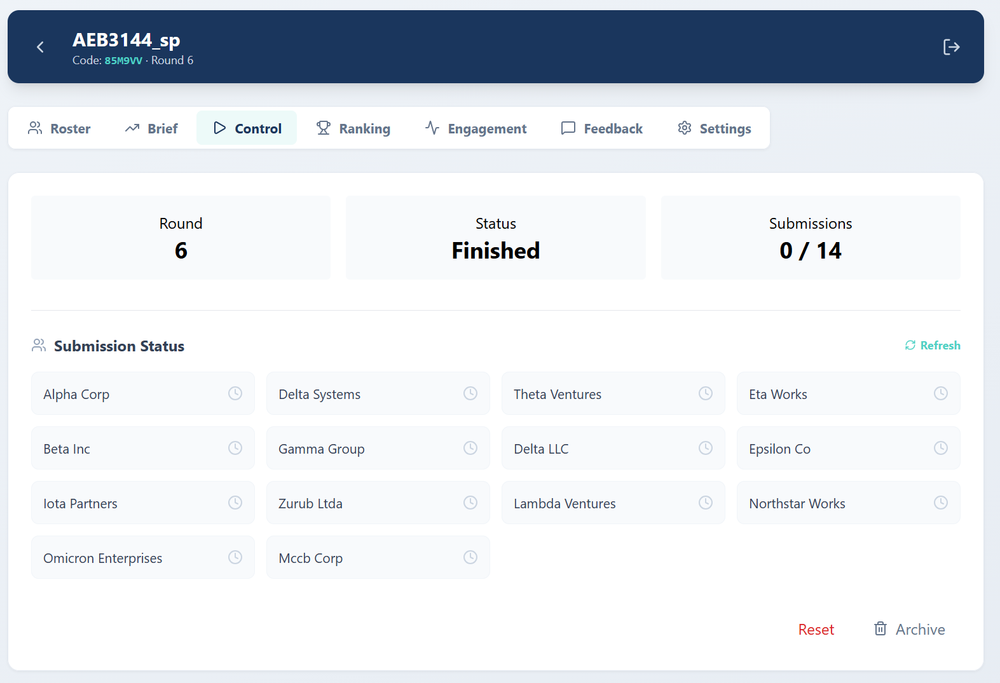

Software and simulations I build alongside the research papers.

## MutandisLab

[Live app](https://mutandislab.com) | [Walk-through post](/blog/2026/05/mutandislab/)

MutandisLab is a platform for classroom simulations across domains. The name comes from the Latin *mutatis mutandis*, "change what must". The first simulation is a business strategy game where student teams run competing firms over six rounds (production, pricing, financing, investment) and are ranked by Economic Value Added. The market clears each round on a shared demand curve. First classroom pilot ran in Spring 2026 with 14 teams. More simulations will follow.

## The LLM Object Table

A public, long-running deliberation on the question *what kind of object is an LLM?*,
staged as a table of five source-grounded agents that argue, reflect, and issue a
weekly joint statement. It grows out of my working paper on how language models
should be characterized in economic research. Available in English and Spanish.

[Enter the deliberation](/projects/deliberation-lab/) ·
[Versión en español](/projects/deliberation-lab/es/)
